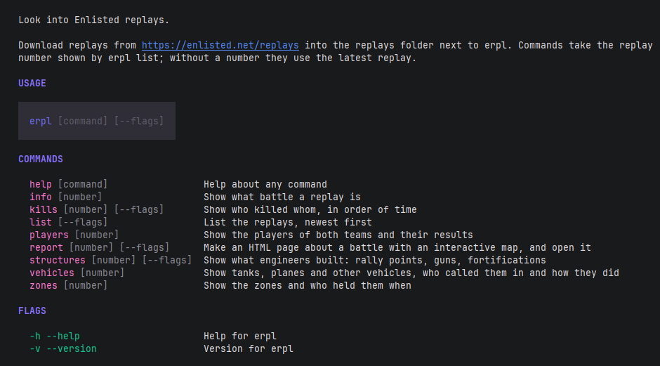

<h1 align="center">erpl-cli</h1>

<p align="center">
  
  
  <a href="LICENSE"></a>
</p>

<p align="center">
  A tool for taking a close look at <a href="https://enlisted.net">Enlisted</a> replays.
</p>

It shows players, kills, vehicles, structures and capture points right in the terminal, and builds an
HTML report with an interactive battle map: where the infantry fought, where the vehicles drove and where
rally points went up.



## Installation

1. Download the archive from [releases](../../releases) and unpack it into any folder.
2. Download replays from [enlisted.net/replays](https://enlisted.net/replays) and put them into the `replays` folder.
3. Open a terminal in that folder and run `erpl list`.

The archive has everything you need:

```
erpl.exe          the main program
erpl-mapgen.exe   updates maps and names after game patches
replays/          put your replays here
reports/          reports are saved here
maps/             map images
data/             map bounds and names from the game
```

## Which replay opens

Every replay has a number. Numbers follow the order in which the files appeared in the folder: the oldest
replay is number 1, and a freshly downloaded one gets the highest number. Without a number, a command opens
the last downloaded replay. To open another one, pass its number from `erpl list`.

```
erpl players
erpl players 3
```

## Commands

### list

The replays in the `replays` folder, newest first. If there are many replays, the list is split into pages.
Pick a page with the `-p` flag.

```
erpl list
erpl list -p 2
```

### info

The map, mode, date, length of the battle, number of players in each team and the game version.

```
erpl info
erpl info 3
```

### players

Players by team: kills, deaths, tanks and planes destroyed, assists, captures and score.
Players from the same platoon share a letter, and bots are labeled.

```
erpl players
erpl players 3
```

### kills

The kill log: who killed whom and when. The `--player` flag shows only kills involving a player whose
name contains the given text.

```
erpl kills
erpl kills 3
erpl kills 3 --player kaban
```

### vehicles

Every vehicle in the battle: who called it in and when, whether it was knocked out, how long it stayed in
the battle and how far it drove.

```
erpl vehicles
erpl vehicles 3
```

### structures

What engineers built. By default structures are grouped by kind: how many each team built, how many were
destroyed and how long they stood on average.

- `-a`, `--all` lists every structure separately: who built it and when, where it stands and when it was destroyed.
- `-k`, `--kind` shows only structures whose id contains the given text, for example `rallypoint`.

```
erpl structures
erpl structures 3
erpl structures 3 -a
erpl structures 3 -a -k rallypoint
```

### zones

Capture points: when each one was active and who held it.

```
erpl zones
erpl zones 3
```

### report

Builds an HTML report about the battle, saves it to the `reports` folder and opens it in the browser.

- `-l`, `--lang` sets the language of the report: `en` or `ru`. The default is `en`.
- `--no-open` only saves the report without opening it.

```
erpl report
erpl report 3
erpl report 3 -l ru
erpl report 3 -l ru --no-open
```

The report is saved as a single file. It opens without the internet, and you can send it to a friend.

## The report

The report helps you break down a battle on the map. At the top of the report you switch between three
modes, and each one shows its own things on the map:

- **Infantry.** The heatmap shows where soldiers spent the most time. You can show just one team and turn
  on the places where soldiers died.
- **Vehicles.** Routes of tanks and cars, where they were called in and where they were knocked out. Hover
  over a route to see which vehicle it is, whose it is and when it was at that spot.
- **Structures.** Rally points and other structures built by engineers. You can turn on the infantry
  heatmap on top of them.

On the right there is a team filter, the map legend and a list that depends on the mode: sectors, vehicles
or structures.

### Stages of the battle

The timeline is at the bottom of the report. The report splits the battle into stages the same way the
game does: each stage is tied to its own capture points. Click a stage to see only that part. You can also
drag over the timeline to pick any stretch of the battle.

For the chosen stretch, the map shows only what happened during that time, along with the capture points
and battle area borders that were active then. The bars on the timeline show how many kills each team made.

## Maps and names

Map images, their bounds and the names of missions, capture points, vehicles and structures in English and
Russian are already in the `maps` and `data` folders. All of it comes from the game files.

If a patch adds new maps or changes names, you can update them yourself. You need the game installed:

```
erpl-mapgen --game "F:\Games\Enlisted"
```

The update takes a couple of minutes. Most of that time goes into finding the map images among the game files.

## Building from source

You need Go 1.26 or newer.

```
go build ./cmd/erpl
go build ./cmd/erpl-mapgen
```

Replays are read by the [erpl](https://github.com/enlisted-stats/erpl) library.

## License

The code is released under the [MIT License](LICENSE). The maps and names from the game in the `maps` and
`data` folders are not covered by it.

## Legal

This is an unofficial project, not affiliated with Gaijin. The maps, names and other game materials in the
`maps` and `data` folders belong to their respective owners.
